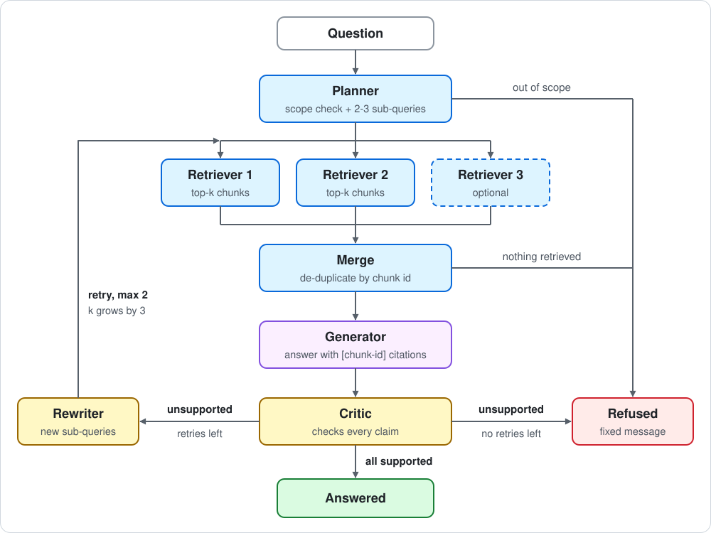
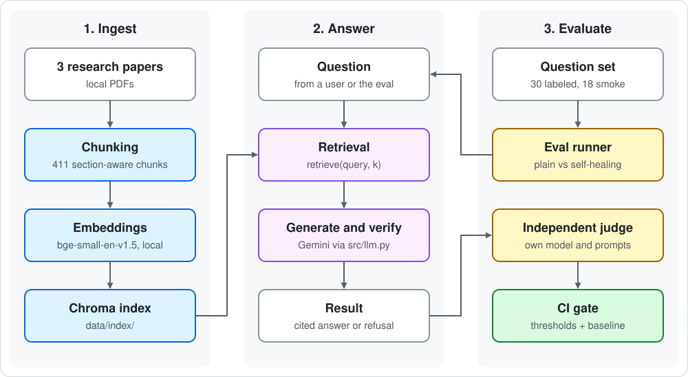

# Self-Healing RAG

A retrieval-augmented question answering system that **checks its own answers**. It answers questions about three research papers (DeepSeek-R1, DeepSeekMath and Dr. GRPO), verifies every claim against the retrieved text, retries with better searches when a claim is unsupported, and **refuses** when it still cannot back the answer.

Built with LangGraph, Gemini, Chroma and local `bge-small-en-v1.5` embeddings, with an independent LLM judge and a CI gate that measures whether the self-healing loop actually helps.

[Results](#results) · [How it works](#how-it-works) · [Quick start](#quick-start) · [Evaluation and CI](#evaluation-and-ci) · [Project layout](#project-layout)

## Results

One smoke run on 25 November 2026: 18 questions, of which 10 are answerable from the papers and 8 are not. Both systems share the retriever, generator prompt and generator model.

| Metric | Plain RAG | Self-healing RAG |
|---|---:|---:|
| Answered / refused | 18 / 0 | 9 / 9 |
| Hallucination rate (share of answered) | 50% (9 of 18) | **0% (0 of 9)** |
| Faithfulness (supported claims) | 0.875 | **1.000** |
| Unanswerable questions correctly refused | 0 of 8 | **8 of 8** |
| Answerable questions wrongly refused | **0 of 10** | 1 of 10 |
| Latency, p50 | **2.2 s** | 15.9 s |
| Latency, p95 | **61.7 s** | 129.1 s |
| Estimated cost for the run (list prices) | **$0.08** | $0.24 |

### Read these numbers carefully

- **The headline gap overstates the difference.** Any answer to an unanswerable question counts as a hallucination, and the plain baseline has no way to set a "refused" status. In 8 of its 9 hallucinations it actually replied in text that the context did not contain the answer. If those text abstentions count as refusals, the result is:

  | | Plain RAG | Self-healing RAG |
  |---|---:|---:|
  | Hallucinated / real answers | 1 of 8 | 0 of 9 |
  | Answerable questions it gave up on | 2 of 10 | 1 of 10 |

- **The sample is small.** This is one run of 18 questions. An earlier run, with an older agent prompt and different models, had one self-healing hallucination in 10 answers.
- **The judge is also an LLM.** This run used `gemini-3.5-flash-lite` for the generator and critic and `gemini-flash-lite-latest` as the judge. The runner compares model *names*, so it cannot detect an alias that resolves to the same underlying model.
- **The cost is notional** and latency was measured on the Gemini free tier.

Source: [`ci/baseline_smoke.json`](ci/baseline_smoke.json), which holds every question, answer, claim and verdict.

## How it works

<picture>
  <source media="(prefers-color-scheme: dark)" srcset="docs/assets/flow-dark.svg">
  
</picture>

| Step | What it does |
|---|---|
| **Planner** | Refuses out-of-scope requests (code, creative writing, chit-chat). Otherwise writes 2 to 3 search queries. If unsure, it treats the question as in scope. |
| **Retrievers** | One per query, run in parallel. |
| **Merge** | Combines the results and removes duplicate chunks. |
| **Generator** | Answers using only the retrieved passages and cites chunk ids. |
| **Critic** | Splits the answer into atomic claims and checks each one against the passages. Output it cannot parse counts as a failure. |
| **Rewriter** | On failure, writes new queries and retrieves more chunks (5, then 8, then 11 per query). At most 2 retries. |
| **Refuse** | Returns a fixed message with no claims. |

The **plain baseline** is `retrieve → generate`, with no planner, critic or retry.

## System overview

<picture>
  <source media="(prefers-color-scheme: dark)" srcset="docs/assets/system-dark.svg">
  
</picture>

## Quick start

You need **Python 3.11 or newer** and a [Gemini API key](https://aistudio.google.com/apikey).

```bash
git clone https://github.com/meghgosar007-droid/Self-Healing-RAG.git
cd Self-Healing-RAG

python -m venv .venv
source .venv/bin/activate        # Windows PowerShell: .venv\Scripts\Activate.ps1
pip install -e ".[dev]"

cp .env.example .env             # then add your GEMINI_API_KEY to .env

# Build the search index from the committed chunks.
# The first run downloads the embedding model.
python -m src.ingestion.ingest --rebuild-index
```

Ask a question:

```bash
python -c "from src.agent.graph import run; s = run('What two biases does Dr. GRPO identify in GRPO?'); print(s['final_status']); print(s['answer'])"
```

Use `run_plain` in place of `run` to compare against the baseline.

### Configuration

Set these in `.env`:

| Variable | Purpose | Default |
|---|---|---|
| `GEMINI_API_KEY` | Required. | none |
| `LLM_MAX_CONCURRENCY` | Maximum simultaneous LLM calls. | `2` |
| `GEN_MODEL` | Generator model (also plans and rewrites). | `gemini-2.5-flash` |
| `CRITIC_MODEL` | Critic model. | `gemini-2.5-flash` |
| `JUDGE_MODEL` | Evaluation judge. | `gemini-2.5-pro` |
| `GEN_MODEL_FALLBACK`, `CRITIC_MODEL_FALLBACK`, `JUDGE_MODEL_FALLBACK` | Used when the primary model is unavailable or out of quota. | `gemini-2.5-flash-lite` |

The defaults are placeholders: choose models your key can access. The evaluation fails if the judge resolves to the same model name as the generator or critic, so check the fallbacks too.

## Evaluation and CI

```bash
pytest                                              # unit tests, offline
python -m eval.runner --mode smoke --fake           # offline dry run with a fake agent and judge
python -m eval.runner --mode smoke                  # 18 questions, calls Gemini
python -m eval.runner --mode full                   # all 30 questions, calls Gemini
python -m ci.gate --result ci/baseline_smoke.json   # run the gate on a saved result
```

Real runs write to `eval/results/`. The judge uses its own prompts, extracts claims independently of the agent's critic, and caches its output on disk.

The gate reads only the self-healing metrics and fails if any rule fails:

| Rule | Limit |
|---|---|
| Hallucination rate | at most 5% |
| False refusal rate | at most 10% |
| p50 and p95 latency | at most 25% above the baseline |
| Corpus and contract version | must match the baseline |

GitHub Actions runs lint, unit tests and static checks (secrets, SDK imports, folder ownership), then the smoke eval and the gate, on pull requests, pushes to `main` and a nightly schedule. The eval needs a `GEMINI_API_KEY` repository secret.

## Project layout

```text
src/
  ingestion/     PDF parsing, chunking, embeddings, Chroma index, retrieve()
  agent/         LangGraph graph, nodes and prompts
  llm.py         the only path to Gemini: concurrency cap, retry, fallback, token tracking
  schemas.py     shared Pydantic models and graph state
eval/            question set, independent judge, metrics, runner
ci/              gate, thresholds, baselines, static checks
data/            source PDFs, chunks.jsonl (411 chunks), manifest.json
tests/           offline test suite
CONTRACT.md      schemas, flow, metric definitions and gate rules
PLAN.md          how the work was split into tracks
```

[`CONTRACT.md`](CONTRACT.md) is the source of truth. Changes land through pull requests on `track/<name>/<topic>` branches.

## Known limitations

- **No full baseline yet.** `ci/baseline_full.json` is a placeholder, so a full-mode gate run fails until it is replaced. CI therefore runs smoke mode everywhere, although the contract calls for full mode on `main` and nightly.
- **Gate thresholds are starting values** that have not been calibrated.
- **Retrieval has no relevance cutoff.** It always returns the nearest chunks, so refusals depend mainly on the planner and critic.
- **Self-healing is slower and costs more,** as the results above show.
- **Fixed corpus.** Only the three papers in `data/papers/` are covered.
